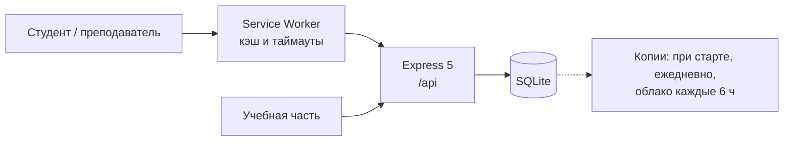

# КАИ Расписание

Сайт с расписанием для студентов и учёт нагрузки преподавателей для учебной части. Делаю для Набережночелнинского филиала КНИТУ-КАИ.


Скоро запускаем пилот в НЧФ КНИТУ-КАИ на 12 группах, несколько студентов уже пользуются. Пока сайт живёт на временном адресе [194-226-123-13.sslip.io](https://194-226-123-13.sslip.io), потом переедет на `nch-kai.schedule.ru`.

## Зачем

У нас расписание выкладывают в VK одной большой Excel-таблицей на все группы. С телефона искать там свою группу неудобно. А часы преподавателей учебная часть считала отдельно, руками.

Идея простая: расписание вносится один раз, и из него получается всё остальное. Студент вводит номер группы и видит свои пары. Преподаватель находит себя по фамилии и видит, сколько часов уже отработал. Таблицу для VK учебная часть выгружает отсюда же.

## Что есть

Для студентов: расписание на телефоне и на компьютере, по дням или списком, тёмная тема, онлайн-пары отмечены отдельно. Сайт ставится на телефон как приложение и открывается без интернета.

<p align="center"></p>

Для преподавателей: страница «Проверить свои часы». Вход не нужен, вводишь фамилию и видишь план по каждой дисциплине и группе, сколько проведено и когда было последнее занятие.


Для учебной части админка. В ней конструктор недель и шаблон, пары сразу на несколько групп (потоки), план нагрузки, закрытие семестра, выгрузка в Excel в том же виде, что официальная таблица, журнал изменений и резервные копии.


## Над чем пришлось подумать

### Часы считаются из расписания

Я решил вообще не хранить часы. Строка плана и пара в расписании связаны, если у них совпадают преподаватель, дисциплина, тип занятия, группа и подгруппа. Связывать руками ничего не надо. Если на прошлой неделе поменяли преподавателя, часы сами перейдут к новому.

Минус такого подхода в том, что одна опечатка, и пара перестаёт считаться, причём незаметно. Поэтому в админке есть список пар, которые не попали ни в одну строку плана.

### Прошлое не переписывается

Когда меняют пару в шаблоне, старая запись остаётся, а рядом появляется новая с пометкой «действует с этой недели». Поэтому прошлые недели и часы за них не меняются. С какой недели действует правка, решает сервер по своим часам, клиент это подставить не может.

### Потоки

Одну лекцию часто слушают сразу три группы. Это одна строка плана, и такая пара засчитывается один раз, 2 часа, а не по 2 за каждую группу. Есть ещё группы, которые учатся вместе: студенты второй группы видят общее расписание под своим номером.

### Сеть в вузе

В корпусе интернет обычно не пропадает совсем, он зависает. Запрос висит 10–20 секунд, и всё это время студент смотрел на пустой экран. Теперь service worker ждёт сеть пару секунд, потом показывает сохранённое расписание с подписью, от какого оно времени. Когда сервер всё-таки ответит, расписание обновится само. На зависшей сети страница открывается примерно за 5 секунд (было больше 25), без сети примерно за 1,5.

Service worker остаётся у людей в телефонах, и если в нём баг, быстро его не откатишь. Поэтому заранее лежит аварийная версия, которая всё за собой удаляет.

### Закрытие семестра

После закрытия итоговые часы фиксируются, и править внутри семестра больше нельзя. Цифры в подписанном отчёте потом не уедут.

### Бэкапы

Копия базы делается при каждом запуске сервера и раз в сутки, плюс каждые 6 часов зашифрованный архив уходит на облачный диск. Перед восстановлением файл проверяется, и если что-то не так, возвращается прежняя база.

## Как делал

Начинали командой. Я был дизайнером, потом стал делать фронтенд. Команда развалилась, и дальше я доделывал всё один, уже около 3 месяцев.

Код я пишу вместе с Claude Code. От меня продукт и дизайн, все экраны и сценарии мои. Я ставлю задачи и принимаю архитектурные решения: что хранить, что считать, как вести версии расписания, что делать при плохой сети. И проверяю результат: тесты, прогон на эмуляции плохой сети, сверка с официальными таблицами Excel по каждой паре, выкладка на сервер и откаты, если что-то сломалось. Правила для ассистента лежат в [`CLAUDE.md`](CLAUDE.md).

## Архитектура



Один процесс и одна база в одном файле, без внешних сервисов. На сервере это VPS, systemd и Caddy для HTTPS.

Стек: React 19 + Vite, Express 5, SQLite (better-sqlite3), Service Worker, тесты на `node:test`.

## Запуск

```bash
npm install
cp .env.example .env     # заполнить JWT_SECRET
npm run dev              # Vite :5173 + Express :3000
npm test                 # 93 теста
```

При первом запуске база создаётся пустой. `npm run seed` заполнит её демо-данными, но сотрёт то, что там было, так что только локально.

## Документация

Подробно про устройство (семестры, чётность недель, шаблон и недели, как считаются часы, API, схема базы, бэкапы) в [`docs/ARCHITECTURE.md`](docs/ARCHITECTURE.md).

---

[@davkchit](https://github.com/davkchit)
