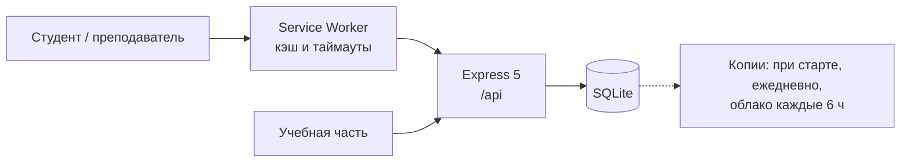

# КАИ Расписание

Расписание занятий и учёт нагрузки преподавателей для Набережночелнинского филиала КНИТУ-КАИ. Для студентов это сайт с расписанием, для учебной части — рабочее место.


**Статус:** готовится пилот в НЧФ КНИТУ-КАИ на 12 группах, первые студенты уже пользуются. На время пилота сайт открывается по временному адресу [194-226-123-13.sslip.io](https://194-226-123-13.sslip.io), постоянный — `nch-kai.schedule.ru` (подключается).

---

## Зачем

Официальное расписание выходит Excel-таблицей в VK: на телефоне в ней приходится искать свою группу среди всех остальных. Часы, которые преподаватель отработал за семестр, учебная часть сводила отдельно от расписания.

Здесь расписание вводится один раз, а дальше из него получается всё остальное:
- студент открывает сайт, вводит номер группы и видит свои пары;
- преподаватель по фамилии видит свои часы;
- учебная часть выгружает ту же таблицу Excel для VK.

## Что умеет

**Студентам** — расписание группы на телефоне и компьютере: по дням или лентой, тёмная тема, отметка онлайн-пар. Работает как приложение (PWA) и без сети.

<p align="center"></p>

**Преподавателям** — «Проверить свои часы» по фамилии, без входа: план по каждой дисциплине и группе, сколько уже проведено, дата последнего занятия.


**Учебной части** — админка:
- конструктор недель и шаблон;
- одна пара сразу для нескольких групп;
- план нагрузки и закрытие семестра;
- выгрузка в Excel в формате официальной таблицы;
- журнал действий, резервные копии и восстановление.


## Интересные задачи

**Часы не хранятся — они выводятся из расписания.** Строка плана и пара в расписании считаются одним и тем же преподаванием, если совпадают преподаватель, дисциплина, тип, группа и подгруппа. Привязывать вручную ничего не нужно. Поменяли преподавателя на прошлой неделе — часы сами ушли от одного к другому. Пары, которые ни к чему не подошли (опечатка, преподаватель вписан руками), система показывает списком: при строгом совпадении без этого часы терялись бы молча.

**Правка не переписывает прошлое.** Пара шаблона не изменяется на месте. Вместо этого появляется новая версия «действует с этой недели», а прошлые недели и часы за них остаются как были. Неделю отсчитывает сервер по своим часам, а не по запросу клиента, поэтому задним числом историю не подменить.

**Потоки и объединённые группы.** Лекция для трёх групп — одна строка плана. Общая пара считается один раз: 2 часа, а не 2 на каждую группу. Группа, которая учится вместе с другой, видит общее расписание под своим номером.

**Сеть, которая «висит».** В вузе сеть чаще не падает, а зависает: запрос не обрывается 10–20 секунд. Service Worker ждёт сеть ограниченное время, затем показывает сохранённое расписание с пометкой, от какого оно времени, и сам подменяет его свежим, как только сервер ответит. На зависшей сети страница открывается за ~5 секунд, а не через 25+, без сети — за ~1,5 секунды. На случай ошибки в Service Worker подготовлена аварийная версия, которая снимает кэш у всех пользователей.

**Закрытие семестра.** Итоговые часы замораживаются, и любые правки внутри семестра отклоняются. Поэтому цифра в подписанном отчёте не меняется, даже когда время идёт дальше.

**Данные не теряются.** Копия базы снимается при каждом старте сервера и раз в сутки, а зашифрованный архив каждые 6 часов уходит на облачный диск. Восстановление проверяет файл перед заменой и откатывается, если что-то пошло не так. Журнал хранит, что и как менялось.

## Как сделан

Проект начинался в команде: я отвечал за дизайн, потом взял на себя фронтенд. Команда распалась, и продукт я довёл сам за ~3 месяца, работая с ИИ-ассистентом (Claude Code) как с основным исполнителем кода.

Моя часть:
- **продукт и дизайн целиком** — сценарии студента, преподавателя и учебной части, интерфейс, визуальный стиль;
- **постановка задач и архитектурные решения** — что хранить, а что вычислять, как версионировать расписание, как вести себя при плохой сети;
- **проверка и отладка** — тесты, эмуляция зависшей сети, сверка данных с официальными таблицами Excel пара в пару, выкладка и откаты на сервере.

Правила, по которым ассистент работает с кодом, лежат в [`CLAUDE.md`](CLAUDE.md).

## Архитектура



Один процесс и одна база-файл, без внешних сервисов и очередей. В проде это VPS, systemd и Caddy (HTTPS).

**Стек:** React 19 + Vite, Express 5, SQLite (better-sqlite3), Service Worker, `node:test`.

## Запуск

```bash
npm install
cp .env.example .env     # заполнить JWT_SECRET
npm run dev              # Vite :5173 + Express :3000
npm test                 # 93 теста
```

База создаётся пустой при первом запуске. `npm run seed` заполняет её демо-данными (стирает текущую — только для локальной разработки).

## Документация

[`docs/ARCHITECTURE.md`](docs/ARCHITECTURE.md) — доменная модель (семестры, чётность, шаблон и недели, версии, часы), API, схема базы, бэкапы, тесты и деплой.

---

Автор — [@davkchit](https://github.com/davkchit): продукт, дизайн, разработка.
