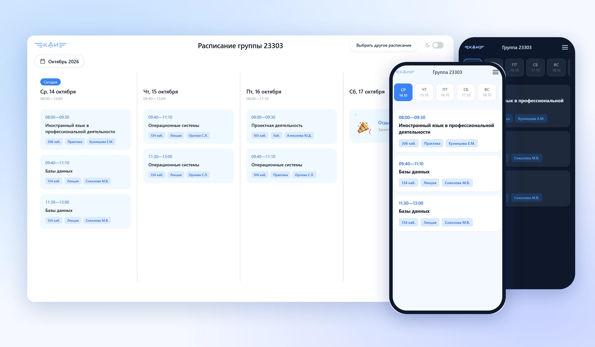
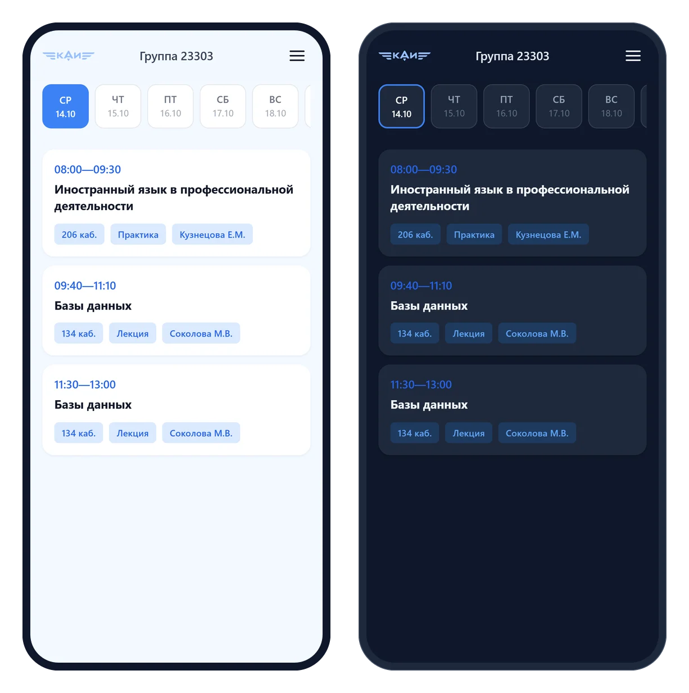
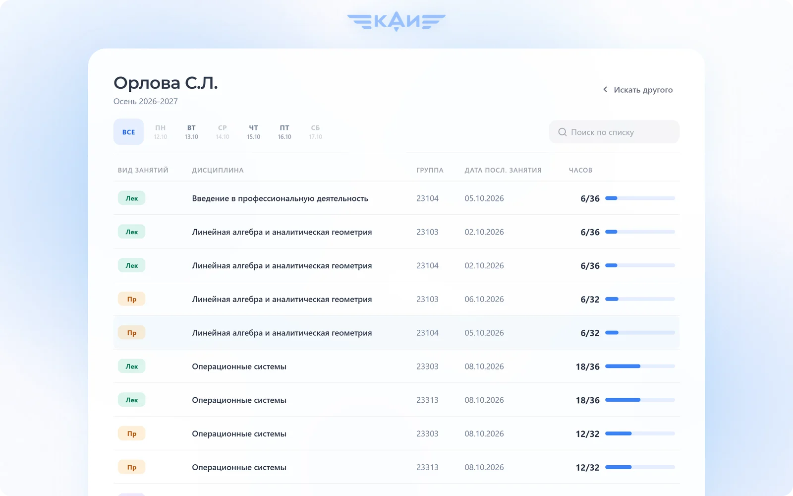
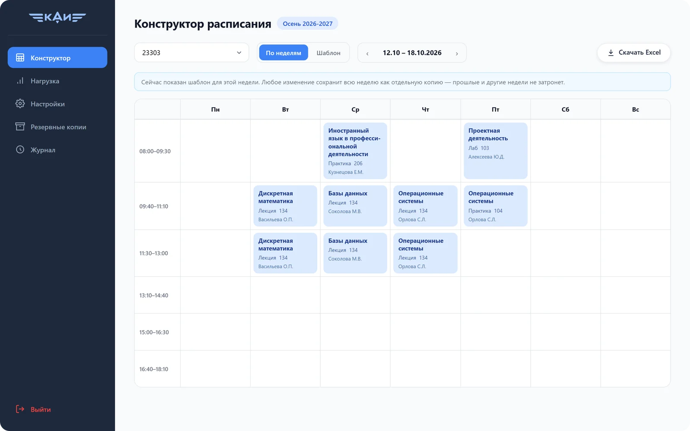
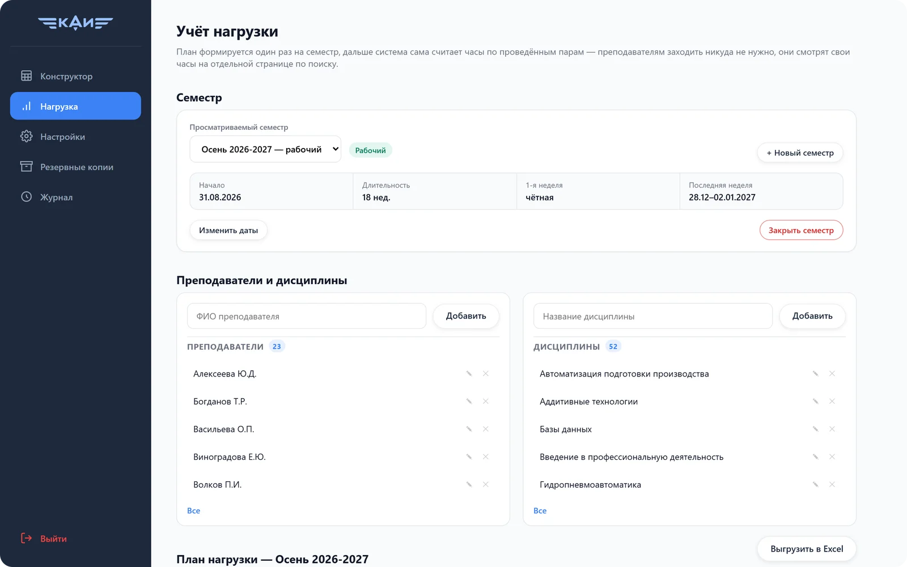
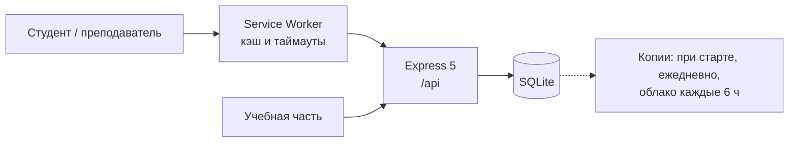

# КАИ Расписание

Веб-приложение с расписанием занятий для студентов и учётом нагрузки преподавателей для учебной части. Разрабатывается для Набережночелнинского филиала КНИТУ-КАИ.




**Статус:** готовится пилотный запуск в НЧФ КНИТУ-КАИ на 12 группах, первые студенты уже пользуются сайтом. На время пилота он доступен по временному адресу [194-226-123-13.sslip.io](https://194-226-123-13.sslip.io). Основной адрес: `nch-kai.schedule.ru`.

## Задача

Расписание филиала публикуется в VK в виде одной Excel-таблицы на все группы, и с телефона найти в ней свою группу неудобно. Часы нагрузки преподавателей учебная часть вела отдельно от расписания, вручную.

В этом проекте расписание вносится один раз, а остальное формируется из него. Студент по номеру группы видит свои пары. Преподаватель по фамилии видит отработанные часы. Учебная часть выгружает отсюда же таблицу для публикации в VK.

## Возможности

**Студентам.** Расписание группы на телефоне и компьютере: по дням или списком, светлая и тёмная тема, отметка онлайн-занятий. Сайт устанавливается на телефон как приложение (PWA) и открывается без интернета.

<p align="center"></p>

**Преподавателям.** Страница «Проверить свои часы» без регистрации: план по каждой дисциплине и группе, количество проведённых часов и дата последнего занятия.



**Учебной части.** Панель администратора:
- конструктор расписания по неделям и шаблон;
- занятия сразу для нескольких групп (потоки);
- план нагрузки и закрытие семестра;
- выгрузка в Excel в формате официальной таблицы;
- журнал изменений и резервные копии.





## Ключевые решения

### Часы вычисляются из расписания

Часы нагрузки не хранятся в базе. Строка плана и занятие в расписании считаются одним и тем же, если у них совпадают преподаватель, дисциплина, тип занятия, группа и подгруппа. Отдельно связывать их не требуется: если в прошедшей неделе заменили преподавателя, часы автоматически переходят к новому.

У строгого совпадения есть недостаток: одна неточность в данных, и занятие перестаёт учитываться. Поэтому в панели администратора выводится список занятий, которые не попали ни в одну строку плана.

### Изменения не затрагивают прошлое

При правке занятия в шаблоне старая запись сохраняется, а новая действует с текущей недели. Прошедшие недели и часы за них остаются без изменений. Неделю, с которой действует правка, определяет сервер, а не клиент.

### Потоки и объединённые группы

Лекция для нескольких групп оформляется одной строкой плана и засчитывается один раз: 2 часа, а не по 2 часа на каждую группу. Для групп, которые занимаются вместе, студенты каждой группы видят общее расписание под своим номером.

### Работа при нестабильной сети

В учебном корпусе сеть чаще не пропадает полностью, а зависает: запрос не завершается 10–20 секунд. Service worker ожидает ответ ограниченное время, после чего показывает сохранённое расписание с указанием времени сохранения. Когда сервер отвечает, данные обновляются автоматически. При зависшей сети страница открывается примерно за 5 секунд вместо 25 и более, без сети примерно за 1,5 секунды.

Ошибку в service worker нельзя быстро исправить на устройствах пользователей, поэтому заранее подготовлена аварийная версия, которая очищает кэш и отключает себя.

### Закрытие семестра

При закрытии семестра итоговые часы фиксируются, а изменения внутри семестра блокируются. Данные подписанного отчёта после этого не меняются.

### Резервное копирование

Копия базы создаётся при каждом запуске сервера и ежедневно. Каждые 6 часов зашифрованный архив отправляется на облачный диск. Перед восстановлением файл проверяется, а при ошибке возвращается предыдущая версия базы.

## Разработка

Проект начинался в команде, где я отвечал за дизайн, а затем за фронтенд. После распада команды я продолжил разработку самостоятельно, сейчас проекту около 3 месяцев.

Код написан с помощью Claude Code. С моей стороны:
- продукт и дизайн: сценарии для студентов, преподавателей и учебной части, интерфейс;
- постановка задач и архитектурные решения: модель данных, версии расписания, поведение при плохой сети;
- проверка: тесты, эмуляция нестабильной сети, сверка данных с официальными таблицами Excel, развёртывание на сервере.

Правила работы ассистента с кодом описаны в [`CLAUDE.md`](CLAUDE.md).

## Архитектура



Один процесс и одна база данных в файле, без внешних сервисов. Развёрнуто на VPS: systemd и Caddy (HTTPS).

**Стек:** React 19 + Vite, Express 5, SQLite (better-sqlite3), Service Worker, тесты на `node:test`.

## Запуск

```bash
npm install
cp .env.example .env     # заполнить JWT_SECRET
npm run dev              # Vite :5173 + Express :3000
npm test                 # 93 теста
```

При первом запуске создаётся пустая база. Команда `npm run seed` заполняет её демо-данными и удаляет текущие, поэтому используется только локально.

## Документация

Устройство системы (семестры, чётность недель, шаблон и недели, расчёт часов, API, схема базы, резервные копии) описано в [`docs/ARCHITECTURE.md`](docs/ARCHITECTURE.md).

---

Автор: [@davkchit](https://github.com/davkchit)
